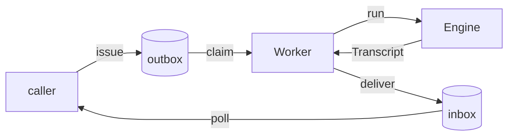

# aifn

An "AI function" is this: its signature is like any other function's, and its body is one agent call.

```python
extract_entities: AiFunction[Document, Entities]
```

All a caller sees is two types: what goes in, and what comes back.
That the body is a model call could have stayed entirely behind the signature.
The reason it cannot is nothing to do with the types and everything to do with how it runs.

## Why it cannot be an ordinary function

On five counts, an AI function behaves the way an ordinary function does on none of them.

**How long it takes is not fixed.**
One call may take seconds or hours, depending on how much the agent has to read.
A call that blocks for hours is one a caller can do nothing beside.

**It fails, and it also refuses, and those are two different things.**
The harness process exiting, the model's stream dropping, a timeout: those are failures, and another attempt might succeed.
The agent reading the input and judging it unanswerable is a refusal: it is a conclusion about the input, and ten thousand retries produce the same sentence.
Merge the two and the caller cannot tell "this input has no answer" from "this never ran", so it either drops what it should retry or retries what it should not.

**The shape of the return value is not guaranteed.**
The return value is generated by a model.
It has to be validated into a declared type, and a validation failure is itself a result to be handled rather than an exception.

**Many of them have to be issued at once.**
A thousand calls, while how many agents can run at once depends on the machine and the quota.
What decides the concurrency is therefore not the caller.

**A whole run may take hours and will crash partway.**
The state is therefore in files and not in a process: the process that issues a call is not the one that runs it, and the one that reads a result is not the one that wrote it.

Taken together, those five say a call cannot be synchronous.
`issue` writes one line into an outbox and returns, and the conclusion turns up later as a file in an inbox.
The concurrency is the number of workers.

## The concepts



**`AiFunction`** is a declaration: a name, an input type, an output type, how an instruction renders a prompt,
which directory the agent runs in and with what permission, which model, how long one attempt is given, and how many attempts at most.
It is data, with no `__call__`: a declaration that can be called has the caller believing it holds a function.

**`Call`** goes into the outbox, and **`Return`** appears in the inbox.
A `Return`'s `outcome` is one of three:
`Returned` carrying a validated value,
`Refused` carrying "why this input has no answer",
`Failed` carrying a `Fault`.
Written as a union with a discriminator,
because one status beside three optional fields permits a line whose status is returned and whose value is absent.

**A `CallId` is a digest of the request.**
This is the library's most consequential decision.
It makes issuing the same call twice do nothing, so a run that went for hours and crashed partway resumes
by running the same program again: a call that already has a conclusion reads it,
and one that does not recognizes itself in the outbox.
Nothing then has to be remembered in a process, because a process cannot remember it.
Sampling twice on purpose and submitting twice by accident differ by `Call.sample`.

**`Mailbox`** is a directory, and the only place the two sides meet.
A worker claims a call by creating a lease file with `O_EXCL`, so
"one call is never claimed by two workers" is guaranteed by the filesystem and depends on no process being alive.
A lease carries an expiry, because a killed worker has no chance to clean its own up:
expiring means it can be taken, and that is the only route by which an unfinished call returns to the queue after a crash.

**`Worker`** claims, runs, and writes the inbox.
Running more of them is more concurrency, and the caller knows nothing about it.

**`Engine`** runs one session and hands back a transcript.
It is a protocol, because a recorded transcript also satisfies it:
`ReplayEngine` is what lets leases, retries and validation be tested without a model.

## How the agent answers

Not in prose.
It is given a submit tool whose arguments are the return value,
with a schema translated from the output type (`submit.parameters`).
A refusal is a tool call too (`refuse_<function>`), because a refusal is an answer:
let the agent say "I cannot answer this" in prose and the transcript holds a session with no tool call in it,
which is exactly what a session that ran off the rails looks like.

The right way to read an answer is "drop the rejected ones and take the last of what is left".
That follows from what a transcript is: a tool's argument check runs before `execute`,
a rejected call neither ends the turn nor trips the guard, the model retries within the same turn,
and both calls leave a `tool/call` event.
The test is the error result the rejected call received, not the success result the accepted one received:
a submit tool ends the turn inside `execute`, so its own result can arrive after the window this run returns.

The harness parameter DSL is a subset of JSON Schema:
it has types, nesting, arrays and enums, and it has no pattern, no bounds and no cross-field rules.
So passing the tool's argument check does not mean passing Pydantic's,
and that case is `Fault.INVALID`, whose error text goes into the next attempt's prompt.

## The dsh bundle

`harness/aifn-harness` is a dsh bundle, installed into a profile once with `dsh plugin add`.
It holds the mechanism for answering a call and knows no AI function's name:
how a tool is registered, how a call ends the turn, and how a second answer is refused.

What this call is arrives as a patch layer.
The tool names and the submit schema come from one function's `returns` model, which exists only in the calling process,
so they cannot be in the bundle: it is installed by being copied, and a bundle carrying a schema
could only ever hold the one it was installed with.
`aifn.patch.layer` produces the rows and `aifn.patch.write` writes them per session,
and `DeepSeekHarness(patches=...)` layers them on after every bundle's own.

A read-only call's layer also disables the shell rows, which makes "this call cannot run commands" structural:
the tool is not in the roster at all, rather than being offered and denied when called.
`write` and `edit` stay, because `tool-fs` registers them alongside `read` with no configuration separating the three;
under read-only the sandbox denies them where they are called.

## A complete example

A two-stage pipeline: read a repository and list its services, then find each service's timeout configuration.
The second stage does not wait for all of the first.

```python
from pathlib import Path
from pydantic import BaseModel
from aifn import (
    Access, AiFunction, Batch, Flow, Link, Mailbox, Model,
    Policy, Registry, Stage, Template, Worker, Workspace,
)
from aifn.engines import DeepSeekEngine


class Repository(BaseModel):
    path: str


class Services(BaseModel):
    names: list[str]


class Service(BaseModel):
    repository: str
    name: str


class Timeouts(BaseModel):
    values: dict[str, int]


workspace = Workspace(directory=Path("/srv/target"), access=Access.READ_ONLY)
model = Model(name="DeepSeek-V4-pro")

list_services = AiFunction(
    name="list_services",
    request=Repository,
    returns=Services,
    instruction=Template(body="List every service in the repository at {path}."),
    workspace=workspace,
    model=model,
    timeout_s=1800.0,
)

read_timeouts = AiFunction(
    name="read_timeouts",
    request=Service,
    returns=Timeouts,
    instruction=Template(body="In {repository}, find every timeout the {name} service configures."),
    workspace=workspace,
    model=model,
    timeout_s=600.0,
)

registry = Registry(functions={})
registry.declare(list_services)
registry.declare(read_timeouts)

mailbox = Mailbox(root=Path("mailboxes/timeouts"))
mailbox.prepare()

# The caller's side: the outbox is written, the call returns, nothing is waited on.
scan = Stage(function=list_services, mailbox=mailbox)
inspect = Stage(function=read_timeouts, mailbox=mailbox)

first = Batch[Services](handles=(scan.issue(Repository(path="/srv/target")),))
pipeline = Flow(
    upstream=first,
    downstream=inspect,
    link=Link(adapt=lambda found: [
        Service(repository="/srv/target", name=name) for name in found.names
    ]),
)

# The worker's side: another process, and as many of them as the concurrency wanted.
worker = Worker(
    mailbox=mailbox,
    registry=registry,
    engine=DeepSeekEngine(dsh_home=Path("/root/.dsh")),
    policy=Policy(attempts=2),
    id="worker-0",
)
worker.work()

# Each upstream conclusion starts downstream; calling `advance` repeatedly is safe.
while not pipeline.done():
    pipeline.advance()

for result in pipeline.issued().settled():
    print(result.id, result.status)
```

Resuming after a crash is running the same program again.
`issue` does nothing for a call already issued, `advance` recomputes what is due from upstream's conclusions every time,
and no step depends on a process remembering where it got to.

`Flow`'s three type arguments are the upstream output, the downstream input and the downstream output,
so mypy reports an `adapt` whose output does not fit downstream on the line that joins them.
Several pipelines advance together with `drain`, which takes the `Advancing` protocol:
the stages of one pipeline have pairwise different types, while `drain` needs only to advance and to ask whether it is done.

## Layout

```
src/aifn/
  terms.py      the id and JSON aliases, importing nothing
  call.py       Call, Return, the three Outcomes, Fault, how an id is computed
  declare.py    AiFunction, Workspace, Model, Instruction, Registry
  submit.py     the submit tools' naming, and how an output type becomes their schema
  patch.py      one call's patch layer: which tools it has, and what it cannot do
  extract.py    reading the one accepted tool call out of a transcript
  engine.py     the Engine protocol, Session, Transcript, sorting exceptions into Faults
  policy.py     which faults to retry, how long to wait, how long a lease runs, how a refusal reaches the next attempt
  mailbox.py    the outbox, inbox, claims and events directories, and taking and returning a lease
  worker.py     claim, run, write back
  compose.py    Handle, Stage, Batch, Link, Flow: the caller's side
  engines/      the Engine implementations: deepseek.py runs a model, replay.py reads a recorded transcript
harness/aifn-harness/
  src/index.js      the two tools, registered from the layer's config
  src/config.js     what the bundle checks about that config
  src/prompts.js    everything the model reads that the bundle decides itself
  cordis.patch.yml  the bundle's own layer: the persona, the roster, and the row to configure
```

One mailbox directory looks like this:

```
mailboxes/<name>/
  outbox/<call-id>.json    one call waiting to be run
  claims/<call-id>.json    one worker's lease on it, with an expiry
  inbox/<call-id>.json     its conclusion
  events/<call-id>/<n>.jsonl   attempt n's whole transcript
  scratch/<call-id>/       the directory copy a private workspace gets
```

`ruff` forbids these modules from importing `aifn.engines`:
a worker holds an `Engine`, not one engine's name.
Only whoever assembles the program reads both the protocol and an implementation.

## Development

```sh
uv sync --all-extras
uv run pytest
uv run ruff check
uv run mypy
```

Install dependencies with `UV_INDEX_URL=https://pypi.org/simple`.

`tests/test_bundle.py` installs the bundle into a dsh home of its own and boots the real runtime against a
recording model endpoint, so it checks that the bundle loads and that the tools the model was offered
are the ones this side derived. It needs no credentials, because the endpoint is the test's own.

This version is types and interfaces, with `NotImplementedError` for the bodies.
`submit.py` and `patch.py` are implemented, and so is the bundle.
