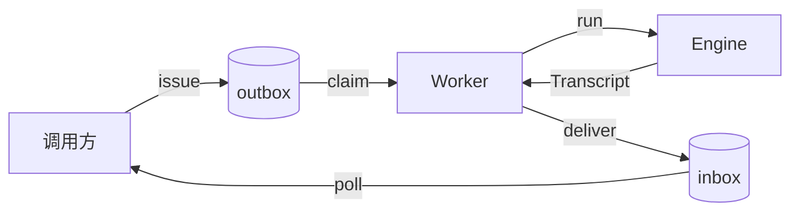

# aifn

一个「AI 函数」是这样一个东西：它的签名像普通函数，它的实现是一次 agent 调用。

```python
extract_entities: AiFunction[Document, Entities]
```

调用方看到的只有两个类型：喂进去什么，拿回来什么。
实现是一次模型调用这件事，本来可以完全藏在签名后面。
藏不住的原因不在类型上，全在执行特性上。

## 为什么它不能是一个普通函数

普通函数在这五件事上的行为，AI 函数一件都不满足。

**耗时不固定。**
一次调用可能几秒，也可能几小时，取决于 agent 要读多少东西。
一个会阻塞几小时的函数调用，调用方没法在它旁边做任何别的事。

**会失败，也会拒答，而这是两件不同的事。**
harness 进程退出、模型断流、超时，是失败：换一次尝试就可能成功。
agent 读完输入判定「这个输入答不了」，是拒答：它是一个关于输入的结论，重试一万次也是同一句话。
把两者合成一种，调用方就无法区分「这个输入没有答案」和「这次没跑起来」，
于是它要么把该重试的丢掉，要么把不该重试的反复重试。

**返回值的形状没有保证。**
返回值是模型生成的。
它必须被校验成一个声明好的类型，而校验失败本身是一种需要被处理的结果，不是一个异常。

**要并发发起很多次。**
上千次调用，而同时能跑几个 agent 取决于机器和额度。
决定并发度的因此不是调用方。

**整个流程可能跑几小时，中途会崩溃。**
状态因此在文件里，不在进程里：
发起调用的进程不是执行它的进程，读结果的进程也不是写结果的那个。

这五件事合起来的结论是：调用不能是同步的。
`issue` 把一行写进 outbox 就返回，结论稍后作为一个文件出现在 inbox。
并发度由 worker 的数量决定。

## 核心概念



**`AiFunction`** 是一个声明：名字、输入类型、输出类型、instruction 怎么渲染 prompt、
agent 在哪个目录以什么权限跑、用哪个模型、一次尝试等多久、最多试几次。
它是一份数据，没有 `__call__`：一个能被调用的声明会让调用方以为自己拿到了一个函数。

**`Call`** 写进 outbox，**`Return`** 出现在 inbox。
`Return` 的 `outcome` 是三者之一：
`Returned` 带一个校验通过的值，
`Refused` 带一句「为什么这个输入答不了」，
`Failed` 带一个 `Fault`。
写成带 discriminator 的联合，
是因为一个 status 加三个可选字段的写法允许出现 status 为 returned 而 value 为空的行。

**`CallId` 是请求内容的摘要。**
这是全库最要紧的一个决定。
它让重复发起同一次调用等于什么也不做，于是一个跑了几小时中途崩溃的流程，
重新运行同一段程序就能接着跑：已经有结论的调用直接读到结论，
还没有结论的调用认出自己已经在 outbox 里。
进程里因此不需要记住任何东西，因为它记不住。
有意重复采样和无意重复提交的区别是 `Call.sample`。

**`Mailbox`** 是一个目录，两侧只在这里相遇。
worker 靠 `O_EXCL` 创建租约文件来认领调用，所以
「同一个调用不会被两个 worker 认领」由文件系统保证，不依赖任何进程活着。
租约带过期时间，因为被中止的 worker 没有机会清理自己的租约：
到期就能被抢走，这是崩溃之后未完成的调用重新回到队列的唯一途径。

**`Worker`** 认领、执行、写 inbox。
多开几个就是多几路并发，而调用方对此一无所知。

**`Engine`** 跑一次会话，交回事件流。
它是一个协议，因为一份录下来的事件流也能满足它：
`ReplayEngine` 让租约、重试、校验这些判断脱离模型被测试。

## agent 怎么回答

不是通过散文。
给它注册一个 submit 工具，工具的参数就是返回值，
schema 由输出类型翻译而来（`submit.parameters`）。
拒答也是一次工具调用（`refuse_<函数名>`），因为拒答是一个回答：
让 agent 用散文说「这个我答不了」，事件流里就只剩一段没有工具调用的会话，
和一次跑飞了的会话长得一模一样。

读答案的正确方式是「丢掉被拒绝的，取剩下的最后一个」。
这是事件流的性质决定的：工具的参数校验在 `execute` 之前跑，
被拒绝的那次调用既不结束轮次也不触发守卫，模型会在同一轮里重试，
而两次调用都会留下 `tool/call` 事件。
判据是被拒绝的那次拿到的 `isError` 结果，不是被接受的那次拿到的成功结果：
submit 工具在 `execute` 内部结束轮次，它自己的结果可能出现在这次 run 返回的活动区间之后。

harness 的参数 DSL 是 JSON Schema 的一个子集：
有类型、嵌套、数组和枚举，没有 pattern、没有取值范围、没有跨字段规则。
所以通过了工具的参数校验并不意味着通过了 Pydantic 校验，
而那种情形算 `Fault.INVALID`，它的错误原文会被写进下一次尝试的 prompt。

## 一个完整的例子

一条两阶段的流水线：读一个仓库列出它的服务，然后为每个服务找出它的超时配置。
第二个阶段不等第一个阶段全部完成。

```python
from pathlib import Path
from pydantic import BaseModel
from aifn import (
    Access, AiFunction, Batch, Flow, Link, Mailbox, Model,
    Policy, Registry, Stage, Template, Worker, Workspace,
)
from aifn.engines import DeepSeekEngine


class Repository(BaseModel):
    path: str


class Services(BaseModel):
    names: list[str]


class Service(BaseModel):
    repository: str
    name: str


class Timeouts(BaseModel):
    values: dict[str, int]


workspace = Workspace(directory=Path("/srv/target"), access=Access.READ_ONLY)
model = Model(name="DeepSeek-V4-pro")

list_services = AiFunction(
    name="list_services",
    request=Repository,
    returns=Services,
    instruction=Template(body="列出 {path} 这个仓库里的全部服务。"),
    workspace=workspace,
    model=model,
    timeout_s=1800.0,
)

read_timeouts = AiFunction(
    name="read_timeouts",
    request=Service,
    returns=Timeouts,
    instruction=Template(body="在 {repository} 里找出 {name} 这个服务的全部超时配置。"),
    workspace=workspace,
    model=model,
    timeout_s=600.0,
)

registry = Registry(functions={})
registry.declare(list_services)
registry.declare(read_timeouts)

mailbox = Mailbox(root=Path("mailboxes/timeouts"))
mailbox.prepare()

# 调用方这一侧：写 outbox 就返回，什么也不等。
scan = Stage(function=list_services, mailbox=mailbox)
inspect = Stage(function=read_timeouts, mailbox=mailbox)

first = Batch[Services](handles=(scan.issue(Repository(path="/srv/target")),))
pipeline = Flow(
    upstream=first,
    downstream=inspect,
    link=Link(adapt=lambda found: [
        Service(repository="/srv/target", name=name) for name in found.names
    ]),
)

# worker 这一侧：另一个进程，开几个就是几路并发。
worker = Worker(
    mailbox=mailbox,
    registry=registry,
    engine=DeepSeekEngine(dsh_home=Path("/root/.dsh")),
    policy=Policy(attempts=2),
    id="worker-0",
)
worker.work()

# 上游出一个结论，下游就开始；`advance` 反复调用是安全的。
while not pipeline.done():
    pipeline.advance()

for result in pipeline.issued().settled():
    print(result.id, result.status)
```

崩溃之后接着跑，就是把同一段程序再运行一次。
`issue` 对已经发起过的调用什么也不做，`advance` 每次重新从上游的结论算出该发起什么，
没有任何一步依赖进程记住上次跑到哪里。

`Flow` 的三个类型参数是上游输出、下游输入、下游输出，
所以一个 `adapt` 产出的东西喂不进下游时，mypy 在接的那一行就报出来。
几条流水线一起推进用 `drain`，它收的是 `Advancing` 协议：
一条流水线上各段的类型两两不同，而 `drain` 只需要推进和问一句完成了没有。

## 目录布局

```
src/aifn/
  terms.py      各种 id 和 JSON 的别名，不导入任何东西
  call.py       Call、Return、三种 Outcome、Fault、id 怎么算
  declare.py    AiFunction、Workspace、Model、Instruction、Registry
  submit.py     submit 工具的命名约定，以及输出类型怎么翻译成它的 schema
  extract.py    从事件流里读出那一次被接受的工具调用
  engine.py     Engine 协议、Session、Transcript、异常怎么归类成 Fault
  policy.py     重试哪些故障、等多久、租约多长、拒绝理由怎么传给下一次
  mailbox.py    outbox、inbox、claims、events 四个目录，以及租约的取得和交还
  worker.py     认领、执行、写回
  compose.py    Handle、Stage、Batch、Link、Flow：调用方那一侧
  engines/      Engine 的实现：deepseek.py 跑模型，replay.py 读录下来的事件流
```

一个 mailbox 目录长这样：

```
mailboxes/<名字>/
  outbox/<call-id>.json    一次待执行的调用
  claims/<call-id>.json    一个 worker 对它的租约，带过期时间
  inbox/<call-id>.json     它的结论
  events/<call-id>/<n>.jsonl   第 n 次尝试的完整事件流
  scratch/<call-id>/       private workspace 的那份目录副本
```

`ruff` 禁止 `aifn.engines` 被这些模块导入：
worker 持有的是一个 `Engine`，不是某一个 engine 的名字。
只有组装程序的人同时读得到协议和实现。

## 开发

```sh
uv sync --all-extras
uv run pytest
uv run ruff check
uv run mypy
```

装依赖时用 `UV_INDEX_URL=https://pypi.org/simple`。

这一版只有类型和接口，函数体是 `NotImplementedError`。
